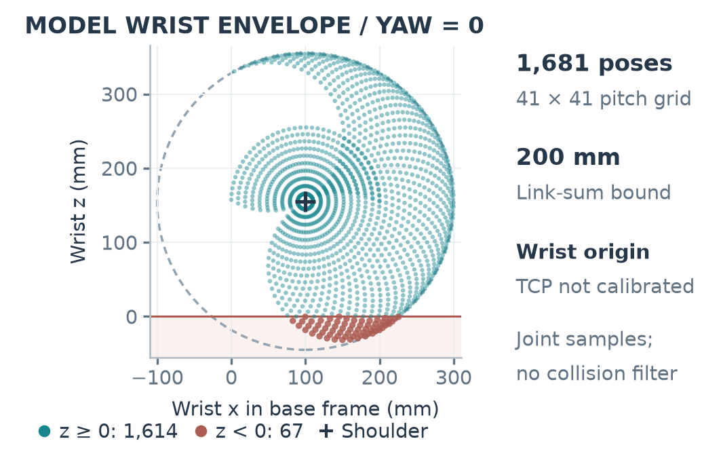
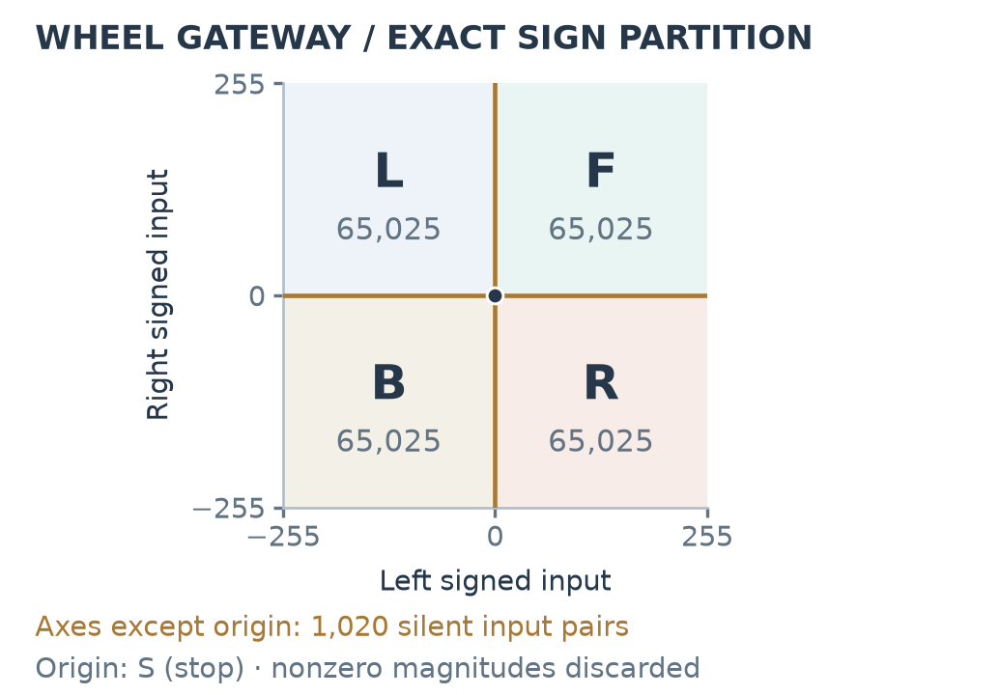

# HazBot technical figures

The active paper presents a Raspberry Pi centred mobile manipulator with four subsystems: visual perception, LiDAR sensing/navigation, wheel drive, and an articulated arm with gripper. The original component symbols are drawn in Python as SVG geometry. Physical interfaces, onboard compute, analytical arm geometry and a reference mission are shown as separate forms of evidence.

| Asset | Exports | Evidence and purpose |
|---|---|---|
| Pi centred hardware architecture | [PDF](hazbot_architecture.pdf) · [SVG](hazbot_architecture.svg) · [PNG](hazbot_architecture.png) · [draw.io](hazbot_architecture.drawio) | Direct CSI camera, sensor controller/USB interface, separate drive and arm Arduino boards, and native Pi inference. Component symbols are schematic. |
| Seven phase reference mission | [PDF](hazbot_mission.pdf) · [SVG](hazbot_mission.svg) · [PNG](hazbot_mission.png) · [draw.io](hazbot_mission.drawio) | SEARCH → APPROACH → DOCK → GRASP → CARRY → PLACE → COMPLETE. Failed prerequisites HOLD the current phase. This is a reference coordination model for surrogate evaluation. |
| Arm reference geometry | [PDF](hazbot_arm_geometry.pdf) · [SVG](hazbot_arm_geometry.svg) · [PNG](hazbot_arm_geometry.png) · [draw.io](hazbot_arm_geometry.drawio) | Source-derived zero coordinates: a vertical 100 mm upper segment, horizontal 100 mm forearm, three positioning axes and a fixed wrist. The fourth command channel controls the gripper. |
| Sampled wrist envelope | [PDF](hazbot_workspace.pdf) · [SVG](hazbot_workspace.svg) · [PNG](hazbot_workspace.png) | All 1,681 yaw-zero poses from the saved joint grid; 67 below-ground poses remain visible. Equal axis scaling, shoulder frame and analytical 200 mm link-sum bound. This is the wrist origin, not a calibrated grasp tool centre point. |
| Optional wheel command partition | [PDF](hazbot_protocol.pdf) · [SVG](hazbot_protocol.svg) · [PNG](hazbot_protocol.png) | Exact sign partition of 261,121 integer wheel input pairs. Each nonzero quadrant maps 65,025 inputs to a single direction; 1,020 mixed-zero cases emit no command; only the origin emits stop. |

The main paper uses the first four assets. The wheel partition is supporting material. Earlier SoccerBot figures remain historical files; the active generator, manifest and gallery use only `hazbot_` assets. The previous case study is preserved in [the dated archive](../archive/SoccerBot_Previous_Case_Study_2026-10-21.zip).

## Reproduce

From the repository root:

```bash
python3 -m pip install -r manuscript/requirements-figures.txt
python3 manuscript/experiments/characterize_hazbot.py
python3 manuscript/scripts/build_figures.py
bash manuscript/compile.sh
```

The characterization reads the URDF and executes isolated, audited pure source fragments. It does not import the robot runtime or connect to motors, serial devices, sockets or ROS. The figure wrapper verifies the recorded CSV and source hashes before plotting. Ordinary LaTeX compilation uses the committed vector PDFs and does not require Python or the rendering tools.

The diagram renderer additionally needs `rsvg-convert` from librsvg and Noto Sans fonts. Its exports use fixed `SOURCE_DATE_EPOCH`. Matplotlib uses embedded TrueType fonts, native vector points/patches, a fixed SVG identifier seed and omitted timestamps. The recorded environment supports byte-identical repeated rendering of all five figure sets.

[build_figures.py](../scripts/build_figures.py) is the active entry point. [render_hazbot_figures.py](../scripts/render_hazbot_figures.py) positions the original component symbols in [hazbot_icons.py](../scripts/hazbot_icons.py). The architecture is 7.1 × 3.6 inches, the mission strip is 7.1 × 1.62 inches, and the arm/reference-envelope pair is 3.45 × 2.25 inches per panel. PNG previews use 300 dpi. Publication PDF/SVG exports contain no raster plots.

## Edit

Edit the Python sources to make reproducible changes. The SVG files retain real text and geometric objects. The three `.drawio` exports contain native text/connector/rectangle cells and separate movable SVG device glyphs. Open them in diagrams.net or its desktop editor. Manual editor changes do not update the renderer automatically. Publication SVG/PDF is the visual authority; editor XML structure and connector references are checked, while interactive draw.io rendering has not been inspected.

## Source and result bindings

- Robot geometry, link lengths, joint axes and the fixed wrist: `scripts/robot.urdf`.
- Native INT8 TFLite detector configuration: `scripts/detect_live_picamera2.py`. Its current two classes are tennis and cricket balls; weights and inference accuracy are not evaluated here.
- Drive hardware/protocol: `motor_control/README.md`, `motor_control/motor_server.py`, and `motor_control/soccer_bot_motor_driver.ino`.
- Separate arm gateway and four servo channels: `scripts/arm_server.py`, `scripts/arduino_arm_controller/arduino_arm_controller.ino`.
- LiDAR scan/controller interfaces: `scripts/lidar_bridge.py`, `scripts/raw_lidar_publisher.py`.
- Design context: the engineering report and presentation under `proposal_resources/`. Conflicting proposals and simulated slide metrics do not become measured paper results.
- Analytical study: [characterize_hazbot.py](../experiments/characterize_hazbot.py), [characterization JSON](../data/hazbot_characterization.json), [workspace CSV](../data/hazbot_workspace.csv), and [protocol CSV](../data/hazbot_protocol.csv).
- Exact selected wrist coordinates, plotted protocol counts and diagram metadata: [figure_data.json](../data/figure_data.json).
- Input, source, generator and export fingerprints plus rendering versions/settings: [figure_manifest.json](../data/figure_manifest.json).

The wrist envelope is sampled ideal source geometry. It excludes collision, torque, contact, cable clearance, stability, servo dynamics and calibrated TCP constraints. Samples below the modeled ground plane expose this limitation; samples above ground are not thereby feasible grasps. Joint-space sampling density is not Cartesian probability or reachable volume. Protocol outputs establish software semantics, not wheel speed or physical stopping. The reference mission and nonhazardous surrogate task do not establish hazardous-material recognition or handling capability.

## Architecture


## Reference mission


## Source arm and wrist envelope




## Optional protocol analysis


