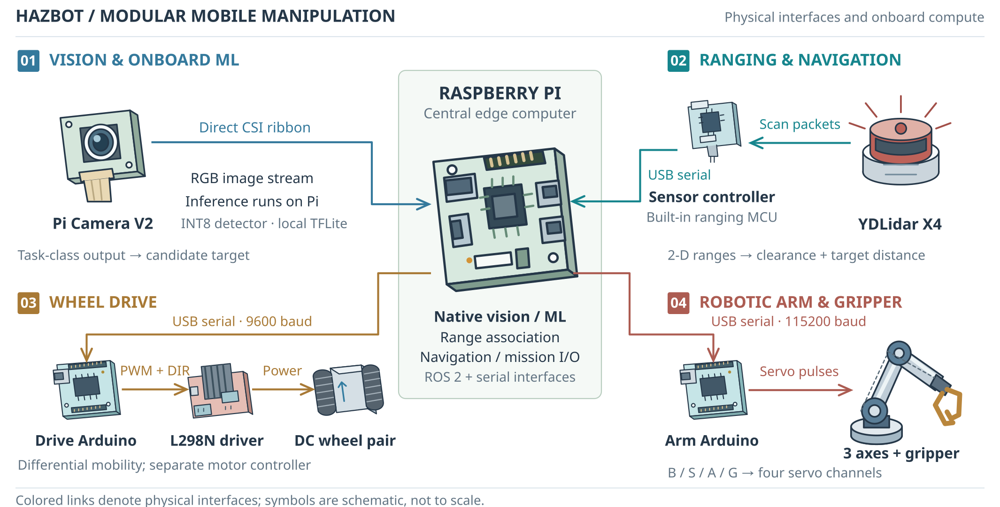
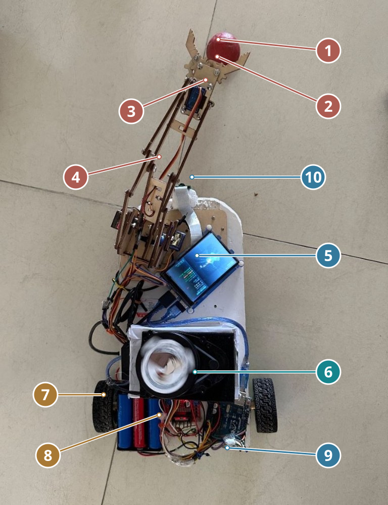
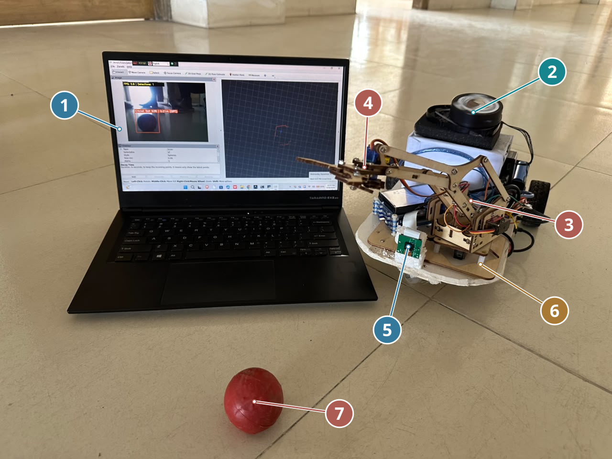
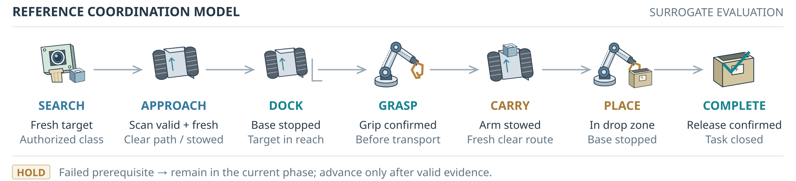
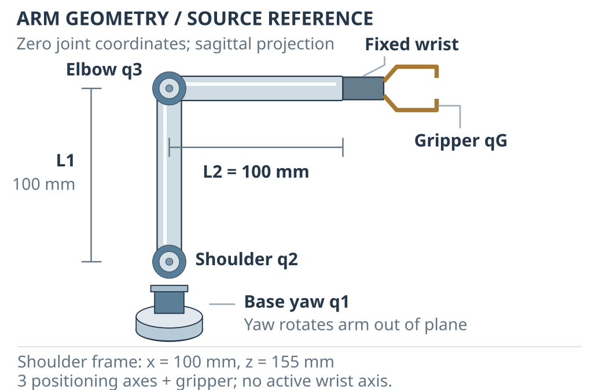

# HazBot figures

The paper uses six technical vector figures, two compact real photographs, and an annotated dashboard screenshot (nine numbered figures). The original hardware architecture is retained. Workflow, methodology and verification are reflowed to single-column vector diagrams; their supplied wide PDFs remain intact. Supplied images remain in photo/bot.png, photo/laptop_front.png, and photo/dashboard_edited.png; compact JPEG derivatives feed the paper renderer, which adds small numbered markers with component and interface keys in the captions.

| Paper asset | Exports | Content |
|---|---|---|
| Hardware interfaces and native compute | [PDF](hazbot_architecture.pdf) · [SVG](hazbot_architecture.svg) · [PNG](hazbot_architecture.png) · [draw.io](hazbot_architecture.drawio) | Four Pi subsystems, native processing, physical interfaces, data flow and command direction. |
| Retrieval workflow | [Compact PDF](worflow-methodology-arch/hazbot_workflow_column.pdf) · [supplied wide PDF](worflow-methodology-arch/hazbot_workflow.pdf) | Sensing, observation records, authority, reference coordinator and separate actuator boards. |
| Study methodology | [Compact PDF](worflow-methodology-arch/hazbot_methodology_column.pdf) · [supplied wide PDF](worflow-methodology-arch/hazbot_methodology.pdf) | Sources, three offline studies, evidence and integration needs. |
| Bounded verification | [Compact PDF](worflow-methodology-arch/hazbot_verification_column.pdf) · [supplied wide PDF](worflow-methodology-arch/hazbot_verification.pdf) | Enumeration, oracle, ablations, counterexample prefixes and reachability. |
| Compact prototype photograph | [PDF](hazbot_prototype.pdf) · [SVG](hazbot_prototype.svg) · [PNG](hazbot_prototype.png) | Original portrait proportions; ten small component markers, including the author-confirmed Pi/GPIO display and CSI camera. |
| Compact front view with laptop | [PDF](hazbot_front.pdf) · [SVG](hazbot_front.svg) · [PNG](hazbot_front.png) | Native landscape proportions; laptop visualization and robot hardware with numbered markers. |
| Reference mission | [PDF](hazbot_mission.pdf) · [SVG](hazbot_mission.svg) · [PNG](hazbot_mission.png) · [draw.io](hazbot_mission.drawio) | Transition prerequisites and commands distinguish stopping, reaching, stowing and observed state. |
| Arm with small wrist-envelope inset | [PDF](hazbot_arm_geometry.pdf) · [SVG](hazbot_arm_geometry.svg) · [PNG](hazbot_arm_geometry.png) · [draw.io](hazbot_arm_geometry.drawio) | Joint frames, rotation axes, fixed wrist, modeled link dimensions and a small source-derived wrist envelope. |

The wheel sign-partition plot is retired from the paper and Overleaf package. Its numerical results remain in the command analysis. The full-size wrist plot is also outside the paper; its [supporting export](hazbot_workspace.pdf) and CSV data remain available for inspecting geometry.

## Reproduce and edit

From the repository root:

```bash
python3 -m pip install -r manuscript/requirements-figures.txt
python3 manuscript/scripts/build_figures.py
bash manuscript/compile.sh
python3 manuscript/scripts/check_submission.py
```

The figure wrapper checks source/data hashes before rendering. Technical SVG comes from render_hazbot_figures.py and hazbot_icons.py; annotate_prototype.py adds photo markers. Source settings, anchors and exact image fingerprints are retained in data/prototype_annotation.json and data/front_annotation.json. Each original photo is preserved; derived embeddings remove metadata without changing decoded pixels.

The photo previews retain their native pixel dimensions. They have no expanded canvas, title banner or wide label panels. Paper photographs occupy one column, with numbered component keys in their captions. Replace photographs only after reviewing anchor positions and captions; recheck the six-page and 3 MB limits.

The arm's small inset samples the zero-yaw wrist origin from the saved URDF analysis. It is ideal geometry, not calibrated contact reach or collision-free grasp feasibility. The physical photographs document hardware arrangement and visualization, rather than measured autonomous mission success.

Three draw.io exports retain editable technical labels/connectors and movable device symbols. Publication SVG/PDF is the visual authority; interactive editor rendering is not checked.

## Provenance and validation

- [Manifest](../data/figure_manifest.json): input, source, renderer and output hashes.
- [Figure data](../data/figure_data.json): exact selected wrist data and diagram/photo metadata.
- [Current integration validation](../data/figure_integration_validation.json): active layout, vector fonts, figure widths and source matching.
- [Earlier figure validation](../data/figure_validation.json): historical rendering and original photo validation.
- [Photo instructions](photos/README.md): source files and manuscript insertion.
- [Previous paper archive](../archive/SoccerBot_Previous_Case_Study_2026-10-21.zip): historical figures.

## Previews










